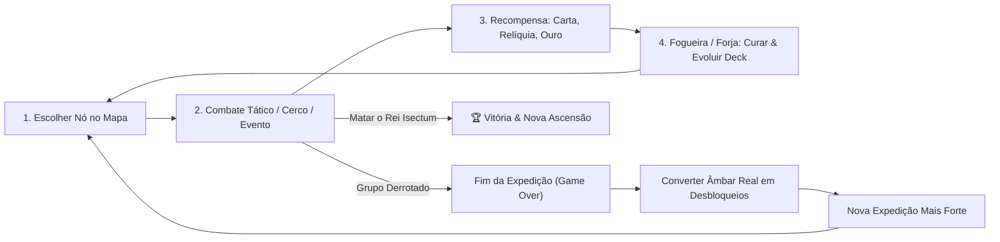

# 🪲 RPG-Battle: A Queda do Rei Isectum
## Documento Oficial de Game Design & Arquitetura — Campanha Roguelike Tática

> **Conceito Central (High-Concept):**
> Um grupo de heróis anões e aventureiros precisa descer da última fortaleza da superfície (*Karak-Dur*) até o abismo da **Colmeia-Mãe**, no coração da terra, para exterminar o **Rei dos Isectum** — uma mente ancestral e terrível que controla todo o enxame. Cada expedição (*run*) é gerada proceduralmente: caminhos, combates táticos, cercos, eventos e relíquias mudam a cada tentativa. A morte é inevitável no início, mas o **Âmbar Real** recuperado fortalece as próximas expedições.

---

## 🔁 1. Loop Central do Jogo (Core Loop)

| Escala | Duração | Decisão Tática Principal |
|---|---|---|
| **Micro (Turno)** | 10–30 s | Posicionamento no grid 20×20, linha de visão, cobertura (+2/+5 CA), sinergia de cartas |
| **Meso (Batalha)** | 5–10 min | Vencer preservando o HP dos heróis (pois o HP **persiste** entre os nós do mapa) |
| **Macro (Expedição / Run)** | 45–90 min | Escolha de rota no mapa ramificado, construção enxuta do deck, combinação de relíquias |
| **Meta (Entre Runs)** | Longo prazo | Gastar **Âmbar Real** para liberar novos heróis, cartas rúnicas, relíquias e níveis de Ascensão |

---

## 🎬 2. Estrutura Narrativa e de Gameplay: Começo, Meio e Fim (3 Atos)

A campanha é dividida em **3 Atos**, aproveitando as 12 fases de `dados/fases/` (`fase_01` a `fase_12`) e as 24 castas de `IsectumCastes.gd`.

---

### 🏰 ATO I — COMEÇO: *"O Cerco da Última Fortaleza"* (Superfície)

- **Contexto Narrativo:**
  A fortaleza anã de *Karak-Dur* sofre o primeiro ataque coordenado em séculos. Os heróis percebem que os insetos não atacam por instinto — eles marcham em formação militar sob o comando de uma frequência psíquica vinda do subsolo.
- **Ambientação Visual & Sonora:**
  Muralhas de pedra sob céu noturno, tochas âmbar oscilando nas quatro torres e miasma verde brotando da floresta externa.
- **Fases Base:** `fase_01` → `fase_04`
- **Inimigos Principais (Castas Tier 1):**
  - *Larva Carniceira* (enxame básico corpo a corpo)
  - *Formiga Correição / Ácida* (corrosão de armadura)
  - *Besouro Gorgulho* (derrubador de barricadas)
  - *Gafanhoto Praga* (saltador de muralhas)
- **O que o Ato I ensina ao jogador:**
  Domínio do grid tático, cobertura atrás de rochas/árvores, economia de cartas (*Movimento*, *Trabalho*, *Escavação*, *Ataque*, *Defesa*) e proteção das muralhas no modo Cerco.
- **Chefe do Ato I:** 🕷️ **Viúva Canibal** (`viuva_canibal`)
  - **Mecânica da Luta:** Emerge de túneis subterrâneos, prende heróis com teias (reduzindo movimento a 0) e se alimenta de larvas menores para se curar se o jogador não limpar as crias antes.
  - **Gancho de Transição (Ato I ➔ Ato II):** Ao abater a Viúva Canibal, os heróis encontram cravado em seu tórax um **Fragmento de Âmbar Real** que pulsa com uma voz grave e ancestral. O chão da câmara cede, revelando a entrada para os Túneis Vivos.

---

### 🕸️ ATO II — MEIO: *"A Descida pelos Túneis Vivos"* (Subterrâneo Profundo)

- **Contexto Narrativo:**
  O grupo desce pelas galerias escavadas sob a montanha. Aqui as paredes de rocha foram substituídas por quitina orgânica e resina. Os heróis encontram patrulhas anãs desaparecidas transformadas em casulos-hospedeiros e descobrem a verdade: a **Rainha do Enxame** gera os exércitos, mas ela própria é serva de uma entidade mais antiga — o **Rei dos Isectum**.
- **Ambientação Visual & Sonora:**
  Escuridão subterrânea (visibilidade reduzida ao redor das tochas dos heróis), paredes bioluminescentes e som abafado de milhares de asas vibrando.
- **Fases Base:** `fase_05` → `fase_08`
- **Inimigos Principais (Castas Tier 2):**
  - *Louva-Deus Ceifador* (alto dano crítico contra heróis isolados)
  - *Vespa Caçadora* (voadora, ignora terreno difícil)
  - *Aranha Clepto* (rouba recursos/ouro ao acertar)
  - *Libélula Blindada* (alta esquiva e mobilidade)
  - *Infiltrador & Vagalume das Sombras* (furtividade e emboscada)
- **Mecânicas Exclusivas do Ato II:**
  - **Casulos de Quitina:** estruturas no tabuleiro que eclodem após 3 rodadas se não forem destruídas.
  - **Eventos de Risco Moral:** salvar mineiros anões presos (gasta PV/tempo da expedição em troca de aliados ou bênçãos rúnicas) ou saquear depósitos antigos da guilda.
- **Mini-Chefe de Elite:** 🦗 **Cigarra Ressonante** (`cigarra_ressonante`) — emite ondas sônicas que aplicam *Atordoado* em área se os heróis ficarem agrupados.
- **Chefe do Ato II:** 👑 **Rainha do Enxame** (`rainha_do_enxame`)
  - **Mecânica da Luta:** Possui habilidade `chamado_da_rainha` (reabastece ninhadas continuamente a cada 2 turnos) e protege-se atrás de guardas reais. O jogador precisa dividir o grupo entre conter a ninhada e focar dano pesado na Rainha.
  - **Gancho de Transição (Ato II ➔ Ato III):** Antes de morrer, a Rainha libera um grito psíquico: *"Vocês matam a carne, mas a Mente é eterna! Enquanto os Três Corações baterem, o Rei jamais cairá!"*

---

### 🔥 ATO III — FIM: *"A Colmeia-Mãe e o Trono de Âmbar"* (O Abismo)

- **Contexto Narrativo:**
  No núcleo geotérmico sob o continente, rios de âmbar incandescente alimentam a **Colmeia-Mãe**. Para tornar o Rei vulnerável, o grupo deve escolher sua rota final através dos **3 Corações da Colmeia** antes de invadir a Sala do Trono.
- **Fases Base:** `fase_09` → `fase_12`
- **Inimigos Principais (Castas Tier 3 / Guarda Real):**
  - *Tarântula Golias & Brutamonte* (colossos de 3 círculos de vida)
  - *Besouro Rinoceronte & Besouro Unicórnio* (investida em linha reta que destrói coberturas)
  - *Escaravelho Necrófago* (reanima carcaças de insetos abatidos)
  - *Mariposa Esfinge & Vespa Joia* (controle mental e maldições)
- **Mecânica dos 3 Corações da Colmeia (`fase_09`, `fase_10`, `fase_11`):**
  No mapa do Ato III, existem 3 nós de Elite Especial (*Corações*). Cada Coração destruído **enfraquece permanentemente o Rei Isectum** na luta final:
  1. 🧠 **Coração da Mente:** Desativa o controle mental do Rei no início da luta.
  2. 🛡️ **Coração da Carapaça:** Reduz a Classe de Armadura (CA) do Rei de 19 para 16.
  3. 🥚 **Coração da Ninhada:** Impede o Rei de invocar guardas reais durante a Fase 2.
  *(Jogadores ousados podem desviar dos Corações para poupar PV, enfrentando o Rei em sua força total em troca de uma conquista suprema e o dobro de Âmbar Real).*

---

## 👑 3. Design do Boss Final: O REI DOS ISECTUM (`rei_isectum`)

> *"O Primeiro Escavador, Senhor da Mente Colmeia, Aquele que Pensa por Um Milhão de Mandíbulas."*

### Ficha Técnica Tática (`fase_12`)

| Atributo | Valor | Observação |
|---|---|---|
| **Tamanho no Grid** | `3×3` tiles | Ocupa 9 células; imune a empurrões |
| **Pontos de Vida (PV)** | `450 PV` | Dividido em 3 Fases de 150 PV cada |
| **Classe de Armadura (CA)** | `19` (`16` sem Coração da Carapaça) | Carapaça de âmbar cristalizado |
| **Imunidades** | *Envenenado*, *Atordoado* | Mente ancestral inabalável |
| **Fraquezas Elementais** | **Fogo (2×)** na Fase 3 | Quando o núcleo de âmbar fica exposto |

### As 3 Fases da Batalha Final

#### ⚔️ Fase 1 (450 ➔ 300 PV): *"O Soberano no Trono"*
- O Rei começa no alto do **Trono de Âmbar** (elevação superior, concedendo vantagem contra ataques de baixo).
- **Habilidade — Comando Absoluto:** A cada rodada, ordena que 2 insetos da Guarda Real realizem um ataque imediato fora de turno.
- **Habilidade — Lança de Âmbar:** Disparo em linha reta que cristaliza o tile atingido, criando um obstáculo no tabuleiro.
- **Objetivo Tático do Jogador:** Usar cartas de *Escavação* para derrubar os pilares que sustentam o trono, forçando o Rei a cair para o nível do chão.

#### ⚔️ Fase 2 (300 ➔ 150 PV): *"A Muralha Viva"*
- O Rei desce para o centro da arena (causando tremor de tela / *Screen Shake*).
- **Arena Dinâmica:** As bordas do grid `20×20` começam a ser tomadas por miasma ácido, forçando o combate para o centro.
- **Habilidade — Rugido Feromônico:** Cone frontal de 4 tiles; heróis atingidos fazem teste de resistência ou sofrem *Medo* (perdem pontos de movimento no turno seguinte).
- **Habilidade — Esmagamento Colossal:** Salto pesado que racha o piso em área `3×3`, causando alto dano contundente.

#### ⚔️ Fase 3 (150 ➔ 0 PV): *"Coroa Quebrada / Desespero do Enxame"*
- A carapaça real se parte: a CA do Rei cai em `-3` e seu núcleo fica exposto (**Fraqueza 2× a Fogo**), mas ele entra em frenesi e age **duas vezes por rodada**.
- **Habilidade Letal — Devorar Essência:** Se um herói cair a `0 PV` (entrando em *Death Saving Throws*) adjacente ao Rei, o Rei tenta consumi-lo no turno seguinte para curar `40 PV`. Os outros heróis têm 1 rodada para resgatar ou curar o aliado caído!
- **Desfecho Épico:** Ao chegar a `0 PV`, o núcleo de âmbar explode em luz dourada, todos os insetos da colmeia entram em colapso simultâneo e a fortaleza é salva.

---

## 🗺️ 4. O Mapa Procedural da Expedição (Estilo *Slay the Spire*)

Cada Ato gera um grafo ramificado de **12 andares** com **4 colunas** e **3 rotas principais** sem cruzamento de arestas:

| Ícone | Tipo de Nó (`RunNode.NodeType`) | Peso | O que acontece |
|---|---|---|---|
| ⚔️ | `COMBAT` (Combate Tático) | 45% | Batalha tática em grid contra um grupo de castas do Ato atual. Recompensa: Ouro + Escolha de 1 entre 3 Cartas. |
| 💀 | `ELITE` (Inimigo de Elite) | 12% | Casta poderosa ou mini-boss (só aparece a partir do andar 4). Recompensa: **1 Relíquia garantida** + Ouro extra. |
| 🏰 | `SIEGE` (Cerco de Posto Avançado) | 10% | Partida rápida do **Modo Cerco** defendendo um entreposto anão por poucas ondas em troca de grandes recursos. |
| ❓ | `EVENT` (Evento Narrativo) | 15% | Encontro de texto interativo com escolhas de risco/recompensa (altares rúnicos, mineiros perdidos, armadilhas). |
| 🔥 | `CAMPFIRE` (Fogueira Anã) | 10% | Sempre presente no penúltimo andar antes do Chefe. Permite **Descansar** (+30% PV no grupo) ou **Forjar** (aprimorar carta). |
| ⚒️ | `FORGE` (Mercado / Forja) | 8% | Gastar ouro acumulado para comprar cartas novas, relíquias ou **remover cartas fracas** do deck. |
| 👑 | `BOSS` (Chefe do Ato) | Fixo | Sempre no último andar do Ato (Andar 11). Vencê-lo cura 25% do grupo e avança para o próximo Ato. |

---

## ♻️ 5. Sistemas Roguelike: Persistência na Run vs. Meta-Progressão

### O que dura apenas UMA Expedição (Resetado ao Morrer):
1. **Grupo de 3 Heróis Selecionados** (ex: *Aquele*, *Stark*, *Elden*).
2. **PV Persistente e Morte Permanente na Run (*Permadeath*):** O dano sofrido em um combate continua no próximo. Se um herói morrer em combate, ele permanece caído pelo resto daquela expedição.
3. **Deck Construído e Aprimorado:** Começa com 10 cartas básicas e cresce conforme o jogador vence nós.
4. **Ouro (`🪙`) e Relíquias Passivas:** Bônus acumulados durante a descida.

### O que é PERMANENTE entre Expedições (Meta-Progressão):
1. **Âmbar Real (`💎`):** Calculado automaticamente ao final da run (`1 por andar vencido + 10 por Chefe derrotado + 25 de bônus ao matar o Rei Isectum`).
2. **Quartel dos Heróis:** Desbloquear os demais 8 heróis de `dados/personagens.json` (*Doom, Gruu, Kuro, Darwin, Novak, Rilem, Yukito, Koema*).
3. **Códice & Bestiário Isectum:** Registra permanentemente as 24 castas enfrentadas e libera a visualização completa de suas fraquezas nos tooltips táticos.
4. **Níveis de Ascensão (1 a 10):** Após derrotar o Rei Isectum pela primeira vez, habilita modificadores de dificuldade crescente para rejogabilidade infinita.

---

## 🏗️ 6. Arquitetura Implementada no Projeto Godot 4

Os **Marcos M1 (Estrutura da Run)** e **M2 (Gerador de Mapa Procedural + Tela de Mapa)** já estão implementados, integrados ao menu principal (`NOVA CAMPANHA` / `CONTINUAR`) e cobertos por testes unitários GUT:

| Arquivo | Responsabilidade |
|---|---|
| [`RunNode.gd`](file:///home/anderson/Documents/projeto/RPG-battle/godot_project/scripts/run/RunNode.gd) | Modelo de dados puro de cada nó do mapa (`COMBAT`, `ELITE`, `SIEGE`, `EVENT`, `CAMPFIRE`, `FORGE`, `BOSS`) com serialização `to_dict()` / `from_dict()`. |
| [`RunMap.gd`](file:///home/anderson/Documents/projeto/RPG-battle/godot_project/scripts/run/RunMap.gd) | Grafo dirigido do Ato, busca por andar, validação de arestas e verificação BFS (`can_reach_boss`) garantindo que nenhum caminho fique sem saída. |
| [`RunMapGenerator.gd`](file:///home/anderson/Documents/projeto/RPG-battle/godot_project/scripts/run/RunMapGenerator.gd) | Gerador procedural determinístico por `seed` com injeção de `RandomNumberGenerator` e algoritmo anti-cruzamento de rotas. |
| [`RunState.gd`](file:///home/anderson/Documents/projeto/RPG-battle/godot_project/scripts/run/RunState.gd) | Máquina de estado da expedição: controla os 3 Atos, chefes (`viuva_canibal`, `rainha_do_enxame`, `rei_isectum`), PV persistente, morte permanente na run, ouro, relíquias e cálculo de Âmbar Real. |
| [`RunNodeResolver.gd`](file:///home/anderson/Documents/projeto/RPG-battle/godot_project/scripts/run/RunNodeResolver.gd) | Estratégia injetável de resolução de nós (fogueiras, eventos, recompensas e gancho para combate tático). |
| [`RunSession.gd`](file:///home/anderson/Documents/projeto/RPG-battle/godot_project/scripts/run/RunSession.gd) | Sessão estática que mantém a expedição ativa entre transições de cenas sem acoplamento global excessivo. |
| [`RunMapScreen.gd`](file:///home/anderson/Documents/projeto/RPG-battle/godot_project/scripts/run/RunMapScreen.gd) & [`RunMapScreen.tscn`](file:///home/anderson/Documents/projeto/RPG-battle/godot_project/scenes/run/RunMapScreen.tscn) | Interface gráfica Dark Fantasy interativa do mapa da campanha, cabeçalho do grupo, barras de PV e log de expedição. |
| [`test_run_map_and_state.gd`](file:///home/anderson/Documents/projeto/RPG-battle/godot_project/test/unit/test_run_map_and_state.gd) & [`test_run_map_screen.gd`](file:///home/anderson/Documents/projeto/RPG-battle/godot_project/test/unit/test_run_map_screen.gd) | Suíte de testes unitários GUT seguindo o padrão **Arrange-Act-Assert (AAA)**. |

---

## 🗺️ 7. Roadmap dos Próximos Passos (M3 a M8)

- [x] **M1 — Estado da Run (`RunState`, `RunSession`)**: Vida persistente, permadeath, ouro, deck, transição de Atos e cálculo de Âmbar.
- [x] **M2 — Mapa Procedural (`RunMapGenerator`, `RunMapScreen`)**: Grafo ramificado determinístico estilo *Slay the Spire* integrado ao Menu Principal.
- [ ] **M3 — Tela de Recompensas, Forja & Relíquias**: Modal de "Escolha 1 de 3 Cartas" pós-combate e catálogo de relíquias passivas conectadas ao `EventBus`.
- [ ] **M4 — Integração Completa do Combate Tático no Mapa (Ato I)**: Ao clicar em um nó `COMBAT`/`ELITE`/`BOSS`, carregar o grid tático com a formação inimiga do Ato I e retornar ao mapa mantendo o PV restante dos heróis.
- [ ] **M5 — Conteúdo do Ato II (Túneis Vivos & Rainha do Enxame)**: Eventos narrativos interativos, mecânica de casulos e luta contra a `rainha_do_enxame`.
- [ ] **M6 — Conteúdo do Ato III (Os 3 Corações & O Rei dos Isectum)**: Batalha final de 3 fases contra o Boss `3×3` `rei_isectum`.
- [ ] **M7 — Meta-Progressão Permanente**: Salvar Âmbar Real em disco, tela de desbloqueio de novos heróis e modos de Ascensão.
- [ ] **M8 — Polimento Final & Epílogo**: Cutscenes de abertura/final e balanceamento das 10 Ascensões.
